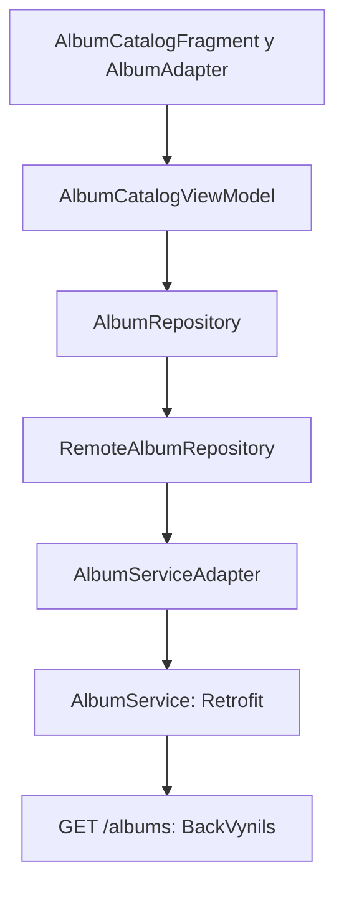

# HU01 — Avance del catálogo

Responsable funcional: @Tibisaytarazona. Issues #1, #2, #3 y #4, Sprint 1.

## Alcance y diseño

El catálogo de Visitante usa una grilla de dos columnas, nombre, portada y artistas,
basada en `images/09-albumes-visitante.png` de la wiki. No muestra acciones de creación.
La búsqueda local filtra nombre/artistas sin distinguir mayúsculas ni acentos.
Los estados son carga, contenido, catálogo vacío, búsqueda sin coincidencias y error
con reintento. Las portadas fallidas tienen un recurso de respaldo.

Esta entrega se limita a HU01. No incorpora selector de rol ni pestañas de historias
posteriores. La selección emite `album_selected` con `albumId: Int` y `albumName: String`
mediante Fragment Result. `MainActivity` muestra un aviso explícito temporal; Hernán
debe sustituir ese listener por la navegación HU02 y consultar el detalle por ID.
La navegación completa catálogo → detalle todavía no se considera terminada.

## Estructura propuesta para revisión de Donaldo

No había proyecto Android en `develop` al iniciar este avance. Se agrega una base
mínima, pendiente de revisión conjunta con el responsable de arquitectura.



- `model`: modelo de álbum usado por la app.
- `data`: contrato Retrofit, DTO, adaptación y repositorio remoto.
- `ui.albums`: estado, ViewModel, Fragment y adaptador visual.
- `VinilosApplication`: composición de dependencias; no guarda referencias a vistas.

El contrato se contrastó con `src/album/album.entity.ts` y `album.controller.ts` de
[BackVynils](https://github.com/TheSoftwareDesignLab/BackVynils), la referencia
que aparece en el README actual. El repositorio `BackVynilssvg` mencionado en
contexto previo no fue accesible en esta revisión; confirmar con el equipo si
la instancia desplegada tiene cambios. Se validan ID y nombre; una respuesta
inválida genera error recuperable, no tarjetas con identificadores inventados.

## Verificación reproducible

```bash
./gradlew testDebugUnitTest lintDebug assembleDebug assembleDebugAndroidTest
./gradlew connectedDebugAndroidTest
```

Las pruebas JVM cubren transformación del JSON, HTTP 503, contrato sin ID, carga,
catálogo vacío, búsqueda y recuperación tras error sin solicitudes duplicadas.
Las pruebas Espresso usan repositorios controlados para contenido/búsqueda,
selección del ID, recreación, catálogo vacío y reintento. No equivalen a E2E
contra el backend desplegado: eso requiere su URL y datos reales disponibles.

Antes de cerrar #4: ejecutar Espresso en emulador/dispositivo, verificar Android 5.0,
probar red caída, imágenes, rotación, fuente grande y registrar resultados reales.
Antes de cerrar #3: integrar el destino de HU02 y validar el flujo con Hernán.

## Revisión del tablero

El 24 de octubre se verificaron los 35 issues: todos tienen responsable,
milestone y etiquetas. Distribución conservada:

| Sprint | Historia / responsable | Issues |
|---|---|---|
| 1 | HU01 / Tibisay | #1–#4 |
| 1 | HU02 / Hernán | #5–#8 |
| 2 | HU03 / Óscar | #9–#12 |
| 2 | HU04 / Donaldo | #13–#16 |
| 2 | HU07 / Tibisay | #17–#21 |
| 3 | HU05 / Óscar | #22–#25 |
| 3 | HU06 / Donaldo | #26–#29 |
| 3 | HU08 / Hernán | #30–#35 |

Los estados del proyecto se deben actualizar según evidencia; una rama o un PR
sin integrar no implica Done. Ningún issue se cierra automáticamente con este avance.

## Referencias técnicas

- [Recomendaciones de arquitectura Android para Views](https://developer.android.com/topic/architecture/views/recommendations-views)
- [Compatibilidad AGP 8.7, Gradle 8.9 y JDK 17](https://developer.android.com/build/releases/agp-8-7-0-release-notes)
- [HU01 y diseño acordado](https://github.com/Osaron/vinilos-android/wiki/HU01-Consultar-cat%C3%A1logo-de-%C3%A1lbumes)
