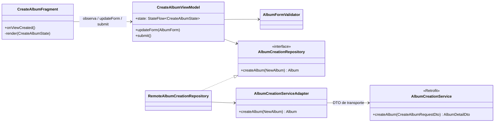
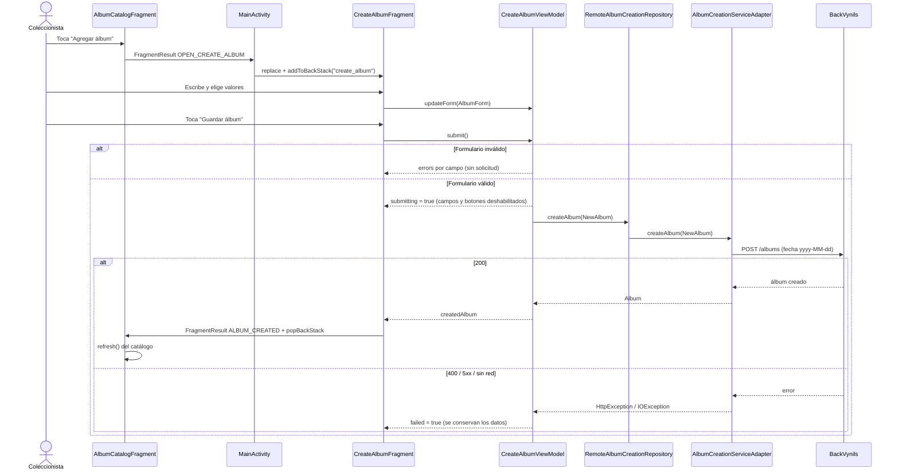

# HU07 – Crear un álbum

Como coleccionista quiero agregar un álbum al listado.

| Issue | Responsable | Alcance |
|---|---|---|
| #17 | Donaldo | Formulario base y navegación del flujo Coleccionista |
| #19 | Donaldo | DTO, Service Adapter y Repository de POST /albums |
| #18, #20 | Óscar | Validaciones, ViewModel y estados (PR #57) |
| #21 | Óscar | Pruebas Espresso de creación, entradas inválidas y red |

## Contrato POST /albums (BackVynils)

Acordado con Óscar a partir de la validación Joi del backend:

| Campo | En pantalla | Se envía | Regla del backend |
|---|---|---|---|
| `name` | Texto | Texto | Obligatorio |
| `cover` | URL (texto) | URL | Obligatorio. No hay endpoint para subir archivos |
| `releaseDate` | `dd/MM/yyyy` | `yyyy-MM-dd` | Obligatorio. La app además rechaza fechas futuras |
| `description` | Texto multilínea | Texto | Obligatorio (no estaba en el diseño; se agregó) |
| `genre` | Lista | Texto | `Classical`, `Salsa`, `Rock`, `Folk` |
| `recordLabel` | Lista | Texto | `Sony Music`, `EMI`, `Discos Fuentes`, `Elektra`, `Fania Records` |

Respuestas: **200** con el álbum creado (`id`, `name`, `cover`, …) y **400** si algún campo no es válido.

## Componentes



Los DTO (`CreateAlbumRequestDto`, `AlbumDetailDto`) no salen de la capa de datos: la UI solo ve
`AlbumForm`, `NewAlbum` y `Album`. En `VinilosApplication.albumCreationRepository` se compone la
implementación real; los tests UI la sustituyen por `DobleCreacionAlbum`.

## Flujo de creación



## Pruebas

| Prueba | Tipo | Qué verifica |
|---|---|---|
| `AlbumCreationServiceAdapterTest` | Unitaria (MockWebServer) | Método, ruta, cuerpo JSON con los seis campos y fecha ISO; transformación de la respuesta 200; propagación de 400, 503 y falta de red; rechazo de respuesta sin `id` |
| `CreateAlbumNavigationTest` | Espresso | Catálogo → formulario → creación → catálogo con el nuevo álbum; Cancelar no envía |
| `CreateAlbumViewModelTest`, `AlbumFormValidatorTest` | Unitarias (Óscar) | Validaciones, estados y doble envío |

Ejecutar localmente:

```bash
./gradlew testDebugUnitTest --tests "*AlbumCreationServiceAdapterTest"
./gradlew connectedDebugAndroidTest -Pandroid.testInstrumentationRunnerArguments.class=co.edu.uniandes.vinilos.CreateAlbumNavigationTest
```

## Decisiones y pendientes

- **Portada como URL:** el backend no recibe archivos; el diseño original (selector de imagen) se reemplazó por un campo de texto.
- **Errores visibles sin foco:** cada campo tiene un `TextView` de error con `accessibilityLiveRegion` en lugar de `EditText.setError`, que solo se ve con foco.
- **Entrada al flujo:** mientras no exista la pantalla de selección de rol, el botón "Agregar álbum" está en el catálogo.
- **Cancelar durante el envío:** los botones se deshabilitan; si el sistema destruye la pantalla en pleno envío, la solicitud puede llegar al backend aunque la app no muestre el resultado.
