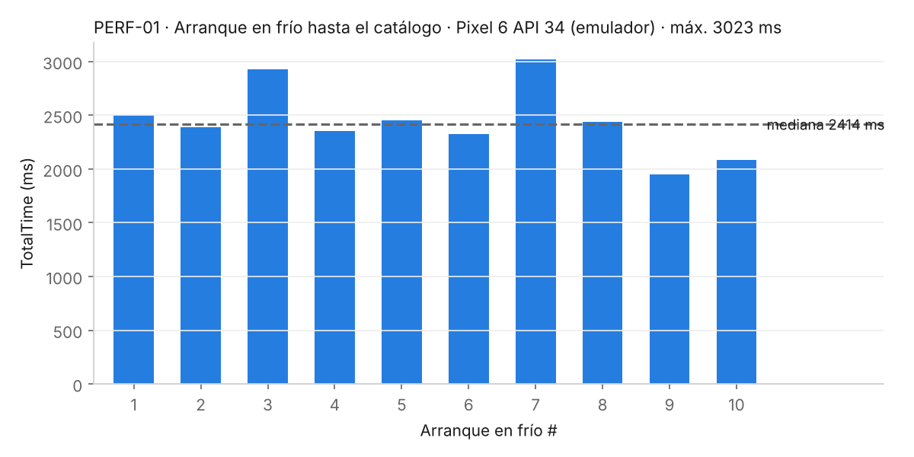
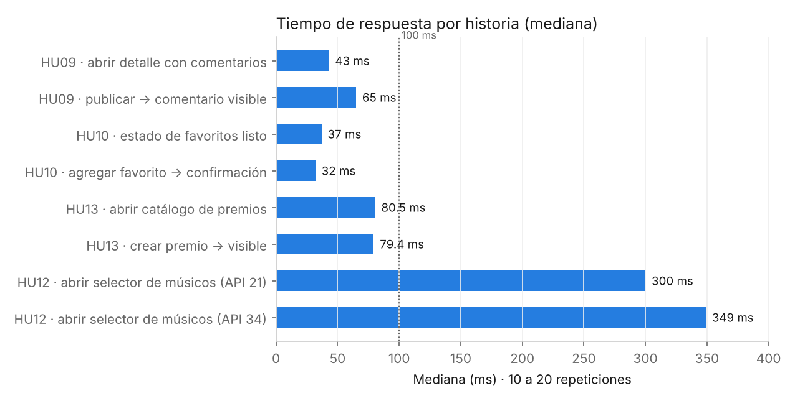
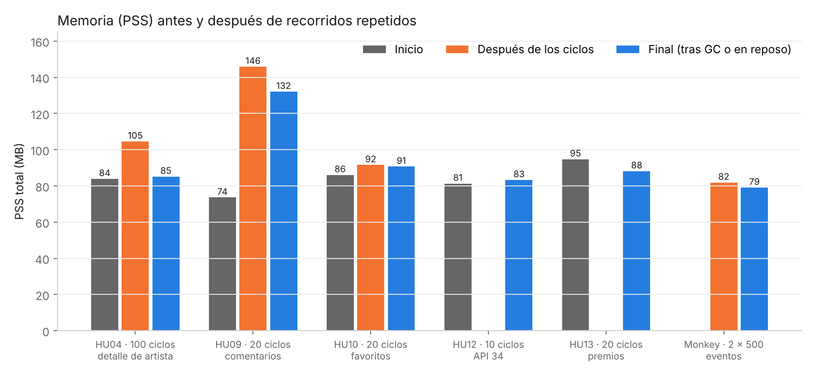
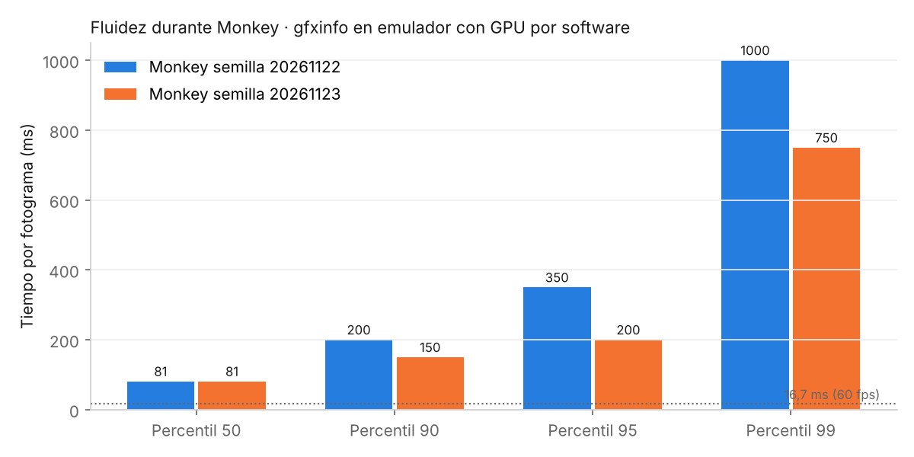
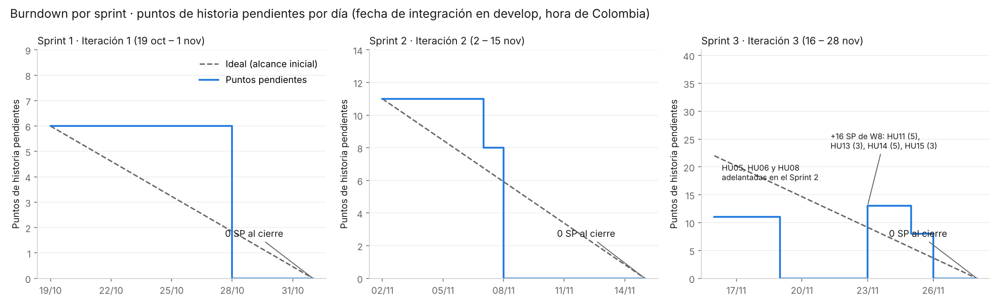
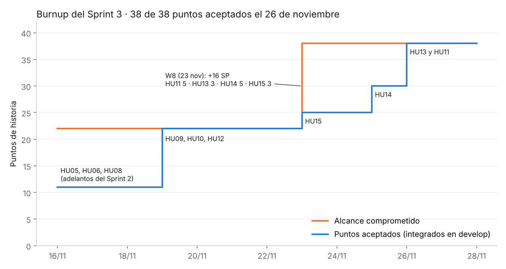

# Resultados de la estrategia de pruebas · Iteración 3 (W8)

Resultados de la [estrategia de pruebas del Sprint 3](https://github.com/Osaron/vinilos-android/wiki/Sprint-3-%E2%80%90-Estrategia-de-pruebas): pruebas E2E, regresión, reconocimiento (aleatorias y exploración sistemática), perfilamiento y accesibilidad. Los datos originales están en [`docs/resultados/w8/`](resultados/w8) y las gráficas, con el script que las genera, en [`docs/graficas/`](graficas).

**Corte probado:** `develop` `28e2d93` (HU01–HU15, igual en código a `main` `5e8609d`, release v0.4.2-w8) y el [PR #149](https://github.com/Osaron/vinilos-android/pull/149) (un solo cliente HTTP y red en `Dispatchers.IO`). Fecha: 26 de noviembre de 2026.

## 1. Resumen

| Tipo | Ejecución | Resultado |
|---|---|---|
| Compilación, unitarias y lint | `./gradlew clean assembleDebug testDebugUnitTest lintDebug` en Windows, JDK 17 | **BUILD SUCCESSFUL** · 261 pruebas JVM (262 con el PR #149) · lint sin errores ([salida](resultados/w8/build-unitarias-lint.txt)) |
| Instrumentadas (Espresso, accesibilidad, desempeño) | `connectedDebugAndroidTest` en Pixel 6 API 34 (emulador) | **131 ejecutadas, 0 fallos**; 11 omitidas porque requieren BackVynils real o TalkBack y corren en sus workflows ([salida](resultados/w8/pruebas-instrumentadas-pixel6-api34.txt)) |
| Regresión en CI | GitHub Actions, emuladores API 21, 29 y 34 | **Aprobada** en el PR de release #148 y en el PR #149 |
| E2E contra BackVynils real | 7 workflows con BackVynils aislado en Docker | **7/7 aprobados** (tabla 2) |
| Reconocimiento aleatorio | Monkey, 2 semillas × 500 eventos | **1000 eventos, 0 cierres, 0 ANR** (sección 3) |
| Exploración sistemática | Recorrido guiado HU01–HU15 | Ver sección 4 |
| Perfilamiento | Arranque, tiempos, memoria y fluidez | Sección 5 |
| Accesibilidad | `AppAccessibilityTest` + Scanner + TalkBack | 0 hallazgos ERROR abiertos ([análisis](https://github.com/Osaron/vinilos-android/wiki/Sprint-3-%E2%80%90-An%C3%A1lisis-de-accesibilidad)) |

## 2. Pruebas E2E

**Con repositorios controlados (Espresso):** escenarios ESC-01 a ESC-59, uno o más por criterio de aceptación de cada historia, en cada PR y en API 21, 29 y 34.

**Contra BackVynils real** (la API es el oráculo: lo que la app muestra o guarda se compara con lo que el backend devuelve):

| Workflow | Historias | PR #148 (release) | PR #149 |
|---|---|---|---|
| Android (regresión + `AppAccessibilityTest`) | HU01–HU15 | [aprobado](https://github.com/Osaron/vinilos-android/actions/runs/45921780344) | [aprobado](https://github.com/Osaron/vinilos-android/actions/runs/45927942870) |
| HU03 Backend real | HU03, HU04 | — | [aprobado](https://github.com/Osaron/vinilos-android/actions/runs/45927943026) |
| HU05 y HU11 Backend real | HU05, HU06, HU11 | [aprobado](https://github.com/Osaron/vinilos-android/actions/runs/45921780317) | [aprobado](https://github.com/Osaron/vinilos-android/actions/runs/45927943043) |
| HU08 Backend real | HU08 | — | [aprobado](https://github.com/Osaron/vinilos-android/actions/runs/45927943008) |
| HU14 Backend real | HU13, HU14 | [aprobado](https://github.com/Osaron/vinilos-android/actions/runs/45921780311) | [aprobado](https://github.com/Osaron/vinilos-android/actions/runs/45927943082) |
| HU15 Backend real | HU15 | [aprobado](https://github.com/Osaron/vinilos-android/actions/runs/45921780347) | [aprobado](https://github.com/Osaron/vinilos-android/actions/runs/45927942936) |
| Portada HTTPS real | HU01, HU02 (API 21 y 34) | — | [aprobado](https://github.com/Osaron/vinilos-android/actions/runs/45927942905) |

## 3. Reconocimiento aleatorio (Monkey)

Emulador Pixel 6 API 34, APK `debug` de `develop` `28e2d93`, BackVynils local.

```
adb shell monkey -p co.edu.uniandes.vinilos -s <semilla> --throttle 200 --pct-syskeys 0 -v -v 500
```

| Semilla | Eventos inyectados | Cierres | ANR | Errores de la app en logcat | PSS al terminar | Salida |
|---|---:|---:|---:|---:|---:|---|
| 20261122 | 500/500 | 0 | 0 | 0 | 81,9 MB | [monkey](resultados/w8/monkey-20261122.txt) · [logcat](resultados/w8/logcat-vinilos-20261122.txt) · [meminfo](resultados/w8/meminfo-20261122.txt) · [gfxinfo](resultados/w8/gfxinfo-20261122.txt) |
| 20261123 | 500/500 | 0 | 0 | 0 | 80,1 MB | [monkey](resultados/w8/monkey-20261123.txt) · [logcat](resultados/w8/logcat-vinilos-20261123.txt) · [meminfo](resultados/w8/meminfo-20261123.txt) · [gfxinfo](resultados/w8/gfxinfo-20261123.txt) |

El logcat filtrado solo muestra advertencias del sistema al cerrar la ventana (`WindowManager`, `InputManager`); no hay `FATAL EXCEPTION` ni `ANR in`. Ninguna corrida produjo un fallo que requiriera un issue.

## 4. Exploración sistemática

La guía por historia está en [Perfilamiento y exploración del MVP W8](https://github.com/Osaron/vinilos-android/wiki/Perfilamiento-y-exploraci%C3%B3n-del-MVP-W8). Los resultados por historia se registran en la wiki, en [Sprint 3 ‐ Artefactos de prueba](https://github.com/Osaron/vinilos-android/wiki/Sprint-3-%E2%80%90-Artefactos-de-prueba), junto con las validaciones independientes de cada integrante (HU08, HU09, HU11, HU12, HU13 y HU14).

## 5. Perfilamiento

Reporte completo y análisis en la wiki: [Sprint 3 ‐ Reporte de perfilamiento](https://github.com/Osaron/vinilos-android/wiki/Sprint-3-%E2%80%90-Reporte-de-perfilamiento).

| Métrica | Resultado |
|---|---|
| Arranque en frío (10 veces, `am start -W`) | Mediana **2414 ms**, mínimo 1951 ms, máximo 3023 ms ([datos](resultados/w8/arranque-frio.txt)) |
| Tiempo de respuesta por historia | 32 a 80 ms en HU09, HU10 y HU13; 300 a 349 ms en HU12 (incluye la sincronización de Espresso) |
| Memoria tras recorridos repetidos | Sin crecimiento sostenido: HU04 vuelve a 85 MB tras 100 ciclos; HU10 +4,6 MB; HU13 baja tras GC; 79 MB en reposo después de 1000 eventos de Monkey ([datos](resultados/w8/meminfo-reposo.txt)) |
| Fluidez (gfxinfo durante Monkey) | p50 81 ms; el emulador dibuja con GPU por software (p50 de GPU 4950 ms), así que el porcentaje de fotogramas lentos no representa un teléfono |
| ANR | 0 en CI, en las mediciones y en Monkey |






## 6. Velocidad del equipo




| Sprint | Compromiso | Aceptado |
|---|---:|---:|
| Sprint 1 | 6 SP | 6 SP |
| Sprint 2 | 11 SP | 11 SP |
| Sprint 3 | 22 SP + 16 SP de W8 (HU11 5, HU13 3, HU14 5, HU15 3) | 38 SP |

Fuentes: fecha de integración de cada historia en `develop` (PR, hora de Colombia) y puntos del [backlog](https://github.com/Osaron/vinilos-android/wiki/Backlog-de-producto). Script: [`graficas/fuentes/velocidad.py`](graficas/fuentes/velocidad.py).

## 7. Cómo repetir

```powershell
.\gradlew clean assembleDebug testDebugUnitTest lintDebug
.\gradlew connectedDebugAndroidTest
.\gradlew installDebug
# Monkey, memoria, fluidez y arranque en frío
adb shell monkey -p co.edu.uniandes.vinilos -s 20261122 --throttle 200 --pct-syskeys 0 -v -v 500
adb shell dumpsys gfxinfo co.edu.uniandes.vinilos
adb shell dumpsys meminfo co.edu.uniandes.vinilos
adb shell am start -W -n co.edu.uniandes.vinilos/.MainActivity
```
